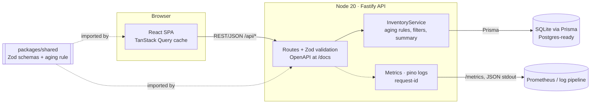
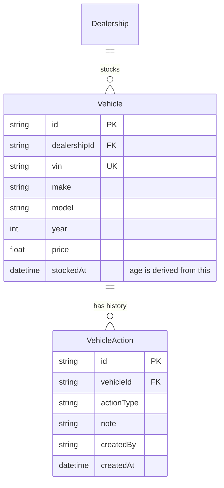
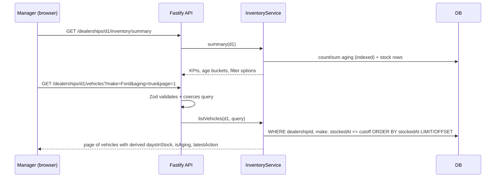

# System Design: Intelligent Inventory Dashboard

Scenario B (Supply). Give dealership managers a real-time overview of vehicle stock, surface **aging stock (> 90 days)** and let them **log a status / proposed action** for each aging vehicle.

## 1. Requirements and assumptions

| # | Requirement | How it is met |
|---|---|---|
| 1 | Filterable list of all vehicles (make, model, age) | `GET /dealerships/:id/vehicles` with `make`, `model`, `minAge`, `maxAge`, `aging`, `q`, sort, pagination. Filtering, sorting and paging run in the database. |
| 2 | Automatically identify and prominently display aging stock (> 90 days) | Age is **derived** from `stockedAt` on every read, so it is never stale. UI: red KPI card, red age buckets, red rows and badges, "Aging stock only" shortcut. |
| 3 | Log and persist a status/action per aging vehicle | `POST /vehicles/:id/actions`, stored in an append-only `VehicleAction` table. The newest row is the current status. The API refuses actions on non-aging vehicles (HTTP 422). |

**Assumptions** (the brief is intentionally ambiguous):

1. *Aging* means **strictly more than 90 days** since `stockedAt`. 90 days is not aging, 91 is. Days are whole UTC calendar days so the result is timezone-independent.
2. *Real-time* means fresh data on load, on window focus and every 30 s (polling). Push (SSE/WebSocket) is a documented next step, not built.
3. One dealership is viewed at a time (dealership switcher). Multi-tenancy is by `dealershipId` on every query.
4. No authentication. The manager's name is a free-text "Logged by" field. In production the identity comes from the auth token.
5. Actions are only allowed on aging vehicles, because the requirement scopes actions to aging stock. This is enforced server-side, not just in the UI.
6. History is append-only. A "change of status" is a new row, giving a free audit trail.
7. Prices are shown in GBP. The currency is a display concern and is not modelled.

## 2. Architecture

### Component roles

| Component | Role |
|---|---|
| **React SPA** (`apps/web`) | Dashboard: KPI cards, age chart, filters, sortable/paged table, action side-panel. TanStack Query caches responses, refetches on focus and every 30 s, and invalidates list + KPIs after an action is logged. |
| **Fastify API** (`apps/api`) | Thin HTTP layer: validates input with Zod, serialises responses, maps domain errors to HTTP codes, exposes `/health`, `/ready`, `/metrics`, `/docs`. |
| **InventoryService** | All business logic: age derivation, the 90-day rule, translating filters into indexed queries, KPI aggregation, the "only aging vehicles can receive actions" rule. Takes an injectable clock so tests are deterministic. |
| **Prisma + SQLite** | Persistence. Schema is provider-agnostic, so moving to Postgres is a `provider` + `DATABASE_URL` change. |
| **packages/shared** | Single source of truth: `AGING_THRESHOLD_DAYS`, `isAging`, `daysInStock`, action catalogue, and the Zod request/response schemas. The frontend and backend cannot drift apart. |

### Data model

Indexes: `Vehicle(dealershipId, stockedAt)` serves the age filter, aging queries and default sort. `Vehicle(dealershipId, make, model)` serves the make/model filters. `VehicleAction(vehicleId, createdAt)` serves "latest action".

**Design decision: age is not stored.** Storing `daysInStock` would need a nightly job and would be wrong between runs. Instead the API converts an age filter into a date range (`minAge=91` becomes `stockedAt <= today-91d`), which uses the index and is always correct.

## 3. Data flow

**Read path (view the dashboard)**

**Write path (log an action)**

1. Manager clicks **Manage** on an aging row and submits the form.
2. `POST /vehicles/:id/actions` is validated (known action type, note <= 500 chars).
3. `InventoryService.logAction` loads the vehicle (404 if missing), recomputes age with the server clock and rejects with **422** if it is not aging.
4. A new `VehicleAction` row is inserted (history is never updated or deleted) and a business metric is incremented.
5. The SPA invalidates the vehicle, list and summary queries, so the status column and the "aging, no action logged" KPI update immediately.

## 4. Technology choices

| Choice | Why | Alternatives considered |
|---|---|---|
| **TypeScript everywhere** | One language and shared types across API, UI and schemas. | Java/Spring (heavier setup for a time-boxed exercise). |
| **Fastify** | Fast, schema-first, built-in structured logging (pino), first-class OpenAPI via plugin. | Express (less built in), NestJS (more ceremony than needed). |
| **Zod + fastify-type-provider-zod** | One schema validates input, types the handler and generates OpenAPI. | Hand-written JSON Schema (duplication). |
| **Prisma + SQLite** | Zero-setup persistence that reviewers can run instantly. Typed queries, migrations path. | Postgres in Docker (better for prod, more friction to run). |
| **React 18 + Vite + TanStack Query** | Server-state caching, background refetch and invalidation are exactly what a live dashboard needs. | Redux (more boilerplate), Next.js (SSR not needed). |
| **Tailwind CSS** | Fast, consistent styling without a component-library dependency. | MUI/Ant (heavy). |
| **Vitest + Testing Library** | Fast, same toolchain for all three packages, `fastify.inject` for API tests without opening ports. | Jest (slower ESM/TS setup). |
| **prom-client + pino** | Standard, vendor-neutral metrics and structured logs. | Vendor SDKs (lock-in). |

## 5. Observability

| Pillar | Implemented | Detail |
|---|---|---|
| **Logging** | Yes | pino JSON logs (pretty in dev). Every request log carries a `reqId`, which is the inbound `x-request-id` if present, otherwise a UUID. It is echoed in the response header and in error bodies so a user report can be traced to log lines. Business events (`action logged`) are logged at info. Unhandled errors are logged at error with stack. |
| **Metrics** | Yes | `GET /metrics` (Prometheus text): `http_request_duration_seconds{method,route,status}` histogram using the *route template* (bounded cardinality), `inventory_actions_logged_total{action_type}`, `inventory_actions_rejected_total`, plus Node process/event-loop defaults. |
| **Health** | Yes | `/health` is liveness. `/ready` runs `SELECT 1` and returns 503 if the DB is unreachable. |
| **Tracing** | **Designed, not built** | Add `@opentelemetry/sdk-node` with Fastify + Prisma auto-instrumentation and propagate W3C `traceparent` (the UI would forward it). `reqId` is already a stand-in correlation id. |

Suggested alerts: p95 latency by route, 5xx rate, `/ready` failing, and a **business** alert on `aging_without_action` growth (a KPI the summary already computes).

## 6. Scalability, performance, reliability, maintainability

- **Performance.** List queries are indexed, paginated (max 100) and filtered in SQL. The UI keeps the previous page visible while the next one loads and caches for 10 s.
- **Scalability.** The API is stateless, so it scales horizontally behind a load balancer. The first bottleneck is SQLite's single writer: move to Postgres (config change), add a read replica for dashboards and `/metrics` scraping.
- **Real-time.** Today: poll + refetch-on-focus. Next: Server-Sent Events from the write path, or Postgres `LISTEN/NOTIFY` fan-out, to push "action logged" and "vehicle just became aging".
- **Reliability.** Graceful shutdown (drain, then disconnect DB). Input is validated at the edge. Append-only history means no lost updates. A future `Idempotency-Key` header would make `POST` retry-safe.
- **Maintainability.** Strict TypeScript. A shared contract package. Business rules isolated in a service with an injectable clock. OpenAPI is generated from the same schemas the code uses, so docs cannot go stale.
- **Security (out of scope, noted).** Add authN/Z (dealership-scoped roles), rate limiting, CORS allow-list and secrets management.

## 7. Known limitations (honest list)

1. **No auth**; `createdBy` is client-supplied.
2. **Summary loads one dealership's stock rows into memory** to compute buckets and filter options. That is fine for thousands of vehicles. At larger scale, replace with SQL `GROUP BY` / a materialised view.
3. **Polling, not push.**
4. **Tracing is documented only.**
5. **Dependency advisories.** `npm audit` reports issues in `zod < 4.6.6` (memory use on oversized *array* validation; this API only validates scalar fields with length limits) and `@fastify/static` (transitively via swagger-ui). Fixing them requires breaking major upgrades (Zod 4 and a matching type provider), which are not done here. Remaining findings are dev-tooling only (vitest/esbuild/postcss).
6. **`light-my-request` is pinned to 6.6.0**: 6.8 depends on an ESM-only `cookie`, which breaks `fastify.inject` on Node 20.11. Remove the override on Node >= 20.19.
7. Not built: Docker/compose, CI pipeline, browser E2E tests (Playwright). The UI was verified manually in a browser and with component tests.

## 8. How GenAI was used in the design phase

*(Written from the actual session; see the README "AI Collaboration Narrative" for implementation.)*

1. **Requirement analysis.** The AI read the brief and extracted the three testable requirements and the ambiguities (what "aging" means at exactly 90 days, what "real-time" means, who may log actions, scope of "each aging vehicle").
2. **Options with a recommendation.** I asked the AI to propose a plan and stack rather than dictate one. It offered backend-only vs frontend-only vs fullstack and several stacks; I chose **fullstack + TypeScript** and approved the written plan before any code was produced.
3. **Design decisions in the approved plan.** Deriving age from `stockedAt` instead of storing it. Enforcing the aging rule server-side. Append-only history. SQLite for reviewer convenience with a Postgres escape hatch. Polling over WebSockets for the time budget. The AI proposed these and the human approved the plan; each is a trade-off the human owns and should be able to defend.
4. **Diagram and document drafting.** The AI drafted the Mermaid diagrams and tables after the implementation existed, so they describe what was built. They should still be reviewed against the code before submission.
5. **Self-critique.** Section 7 lists what the design does *not* do (auth, push, tracing, advisories), stated plainly rather than hidden.
